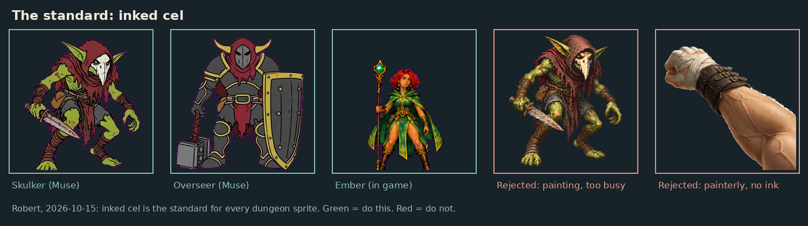
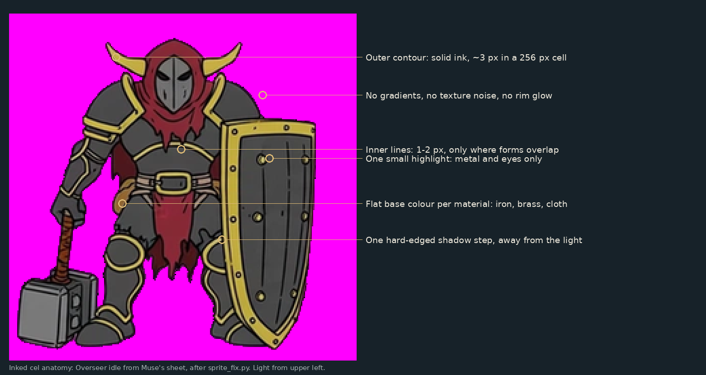
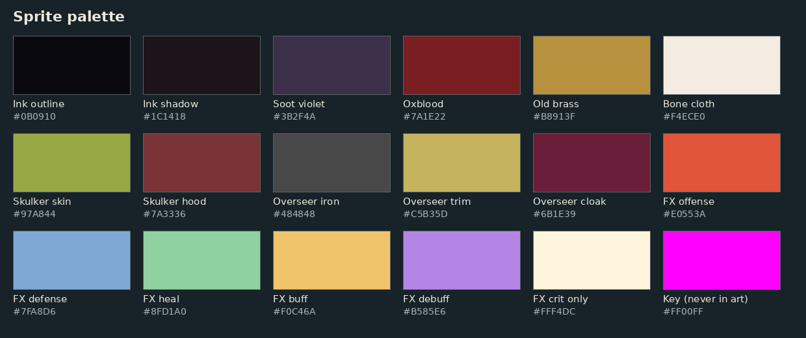
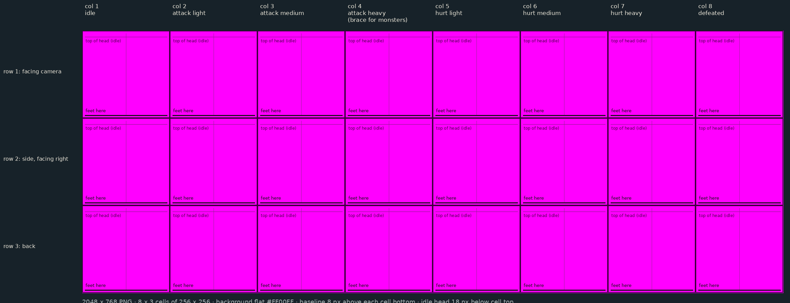
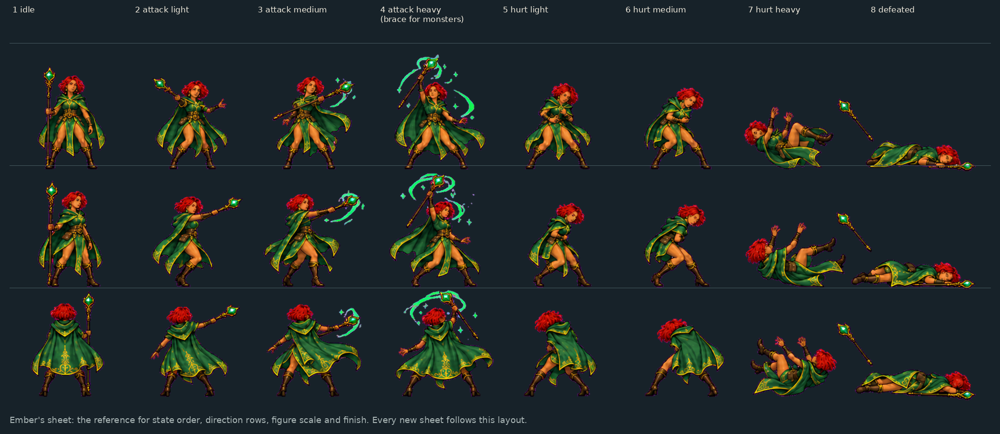
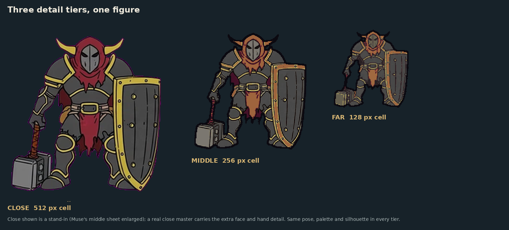
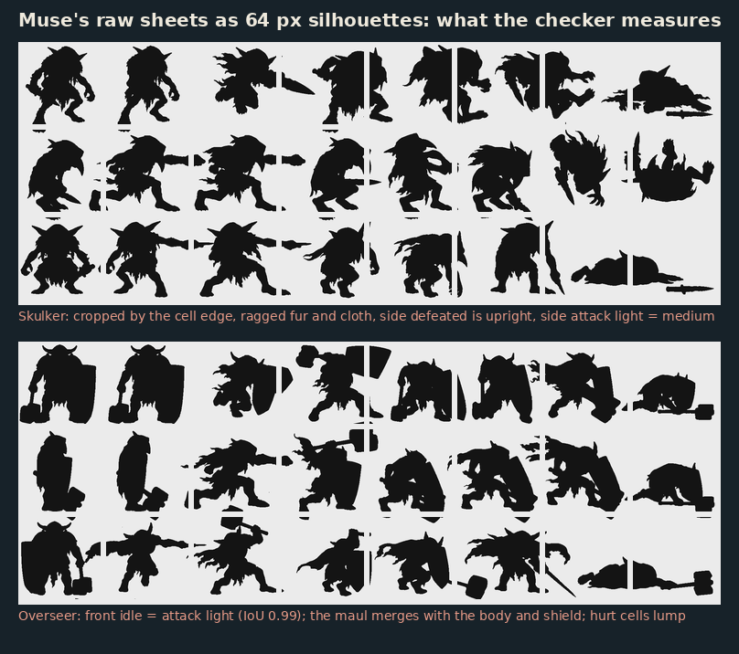
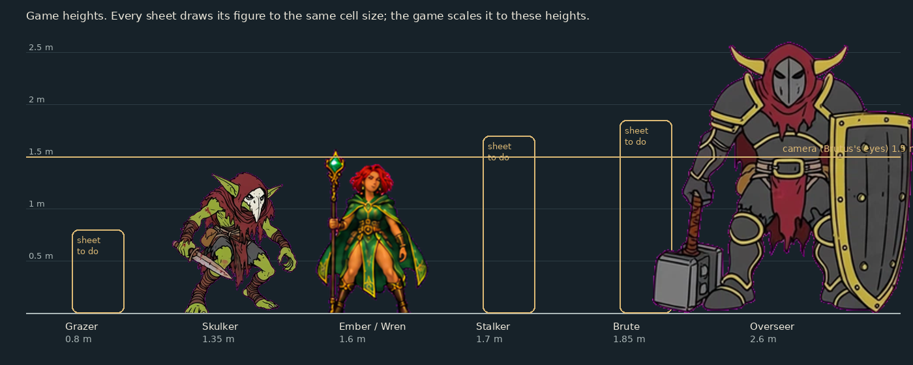
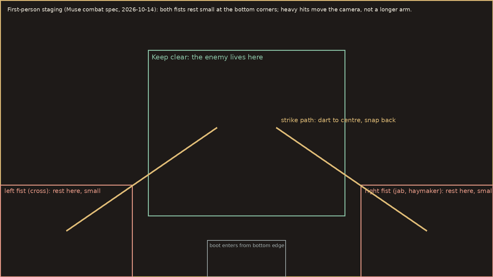
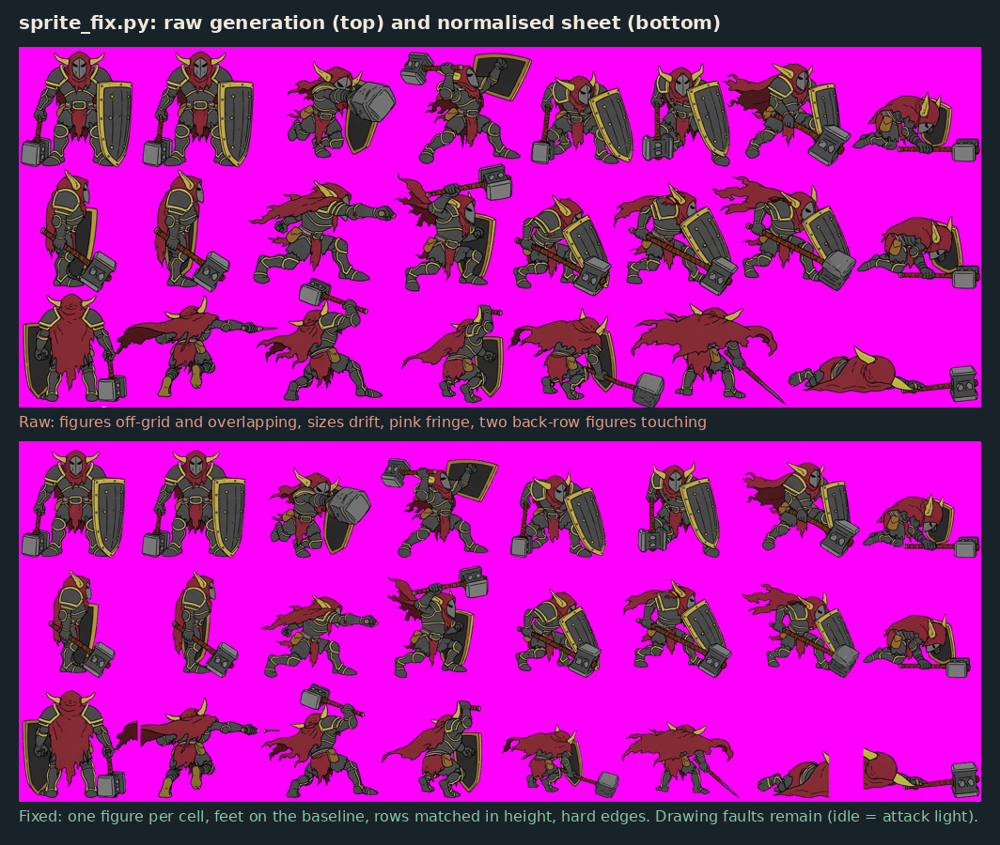

# Dungeon sprites: the guide for Grok and GPT

For anyone generating dungeon art for The Ballad of Brutus with an image model (Grok, GPT, or
another), and for Muse, who runs the work. It sits under the main visual guide
(`../README.md`, binding on all image work) and turns it into rules for one job: the figures
you fight beside and against inside the dungeon.

Written 2026-10-15 by Claude at Robert's request ("I want an in-depth visual guide for grok/gpt
for dungeon sprites"). Rendering style decided by Robert the same day: **inked cel**.
Built from what the first three deliveries (Skulker, Overseer, Brutus's fists) got right and wrong.

Contents
1. The look in ten rules
2. Inked cel, exactly
3. Palette
4. The sheet: format, states, directions
4a. Detail tiers: close, middle, far
4b. Silhouette read (the hard rules)
5. Size and scale
6. Poses that read in a fight
7. Figure bible (every sprite, its job, its locked details)
8. Brutus in first person
9. How to prompt Grok and GPT
10. Clean-up: `sprite_fix.py`
11. Checking: `sprite_check.py` and the human pass
12. What went wrong so far, and the fix
13. Delivery
14. Reference: Nighcisa, and the other images

Every image this guide mentions is in this folder.

---

## 1. The look in ten rules

1. **Inked cel, always.** Solid ink outline, flat colour, one hard shadow step. No painterly
   rendering, no photo texture, no soft airbrush (Robert, 2026-10-15).
2. **Body first.** Robert, 2026-10-12: *"Think SMT / Street Fighter 3rd Strike. Bodies must be
   extremely readable. The goal is smooth movement, so sprites can't be visually noisy."*
3. **One figure, one silhouette.** Filled solid black at 64 px tall, you can still say what it
   is and what it's doing (`ref-04-silhouette-test.png`).
4. **Light from the upper left**, in every cell of every sheet.
5. **Detail lives in three places:** the face (or mask), the hands, and the weapon. Everything
   else is big flat shapes.
6. **Props never change.** A creature carries the same weapon in all 24 cells. (The first
   Overseer pass grew a sword in the defeated cells; it only owns a maul.)
7. **Same size from every side.** Front, side and back views are the same creature at the same
   height.
8. **The tell is the pose.** Wind-ups and braces are exaggerated anticipation; the player reads
   danger from the body, not from effects.
9. **Saturation only at the point of action.** Bodies stay in the muted palette; colour comes
   from effects, never from a full-figure glow.
10. **Clean edges.** No pink fringe from the magenta key, no white halo from a cut-out
    (`ref-05-edges.png`).



---

## 2. Inked cel, exactly



At the sheet's native size (figure about 230 px tall in a 256 px cell):

| Element | Rule |
|---|---|
| Outer contour | Solid ink `#0B0910`, about 3 px, unbroken. It is what separates the figure from a dark dungeon. |
| Inner lines | 1–2 px ink, only where forms overlap: plate edges, a belt, a cloak fold, the line of a jaw. |
| Base colour | One flat colour per material (iron, brass, leather, cloth, skin). |
| Shadow | One step darker, hard-edged, on the side away from the upper-left light. Never a gradient. |
| Highlight | One small hard shape, on metal and eyes only. Skin and cloth get none. |
| Texture | None. No stone grain, no fabric weave, no pores, no scratches. Wear is a line, not noise. |
| Glow, rim light, bloom | None on the figure. Effects belong to the game (impact flashes are code). |

**Why:** the game shows these figures small, moving, and tinted (wind-up tints amber, hurt
tints red, stun tints blue). Flat colour tints cleanly; painted texture turns to mud. Street
Fighter 3rd Strike holds up at speed for the same reason: big shapes, clean contour, controlled
shading.

**Matching what's already in the game:** Ember and Wren (`ref-03-states-on-ember.png`) and Muse's
Skulker and Overseer sheets are the standard. The old Grok paintings (busy) and the painterly
fist frames (no ink) are what not to do.

---

## 3. Palette



- **Base (every figure):** ink outline `#0B0910`, ink shadow `#1C1418`, soot violet `#3B2F4A`,
  oxblood `#7A1E22`, old brass `#B8913F`, bone cloth `#F4ECE0`. From the main visual guide.
- **Locked character colours** (sampled from approved sheets; match them on re-draws and
  variants): Skulker skin `#97A844`, hood `#7A3336`; Overseer iron `#484848`, trim `#C5B35D`,
  cloak `#6B1E39`.
- **Effect colours** (only in attack effects, never on bodies): offense `#E0553A`, defense
  `#7FA8D6`, heal `#8FD1A0`, buff `#F0C46A`, debuff `#B585E6`. Crit white `#FFF4DC` is reserved
  for crits, which the game draws itself.
- **Never use `#FF00FF` or anything near it in the art.** It is the background key; the game
  deletes it. Avoid hot pink and bright magenta-purple entirely.

Give every new figure a locked palette of 4–6 flats plus the base, and write it in the delivery
note.

---

## 4. The sheet: format, states, directions
4a. Detail tiers: close, middle, far
4b. Silhouette read (the hard rules)



- **The master is the close tier: one PNG per figure, 4096 × 1536, 8 columns × 3 rows of 512 × 512
  cells** (section 4a). Middle (2048 × 768, 256 px cells) and far (1024 × 384, 128 px cells) are
  derived from it by `sprite_tiers.py`. Pixel numbers elsewhere in this guide are written for a
  256 px cell; multiply by 2 for the close tier and halve for far.
- **Background flat `#FF00FF`** (exact), or a transparent PNG. A blank canvas is in this folder
  (`blank-sheet-2048x768-magenta.png`; scale it 2x for the close master).
- **Feet on the baseline,** 8 px above the bottom of each cell. Horizontally, the body's centre
  sits on the cell's centre line. Weapons and cloaks may reach toward the edges but must stay
  3 px inside the cell.
- **Idle fills the cell:** top of the head about 18 px below the cell top. The game sets the
  real size per creature (section 5), so draw every figure as big as the cell allows.

**Columns (states), left to right:**

| Col | State | What it must show |
|---|---|---|
| 1 | idle | Ready stance; weight low; weapon held the way it attacks. The pose the player sees most. |
| 2 | attack light | Quick strike at full extension: a jab, a stab, a short swing. Small commitment. |
| 3 | attack medium | Bigger arc, body rotated into it. Clearly larger than column 2. |
| 4 | attack heavy (monsters: **brace**) | Monsters: planted, armoured, weapon or shield set, ready to absorb two hits. Companions: their biggest attack. Must be unmistakable from column 3. |
| 5 | hurt light | Small flinch; head and shoulders back. Feet stay planted. |
| 6 | hurt medium | Knocked off balance; one foot lifting; weapon arm thrown wide. |
| 7 | hurt heavy | Thrown: body airborne or twisting, weapon loose. The biggest shape change in the sheet. |
| 8 | defeated | Down on the ground, flat and still. A dropped weapon may lie beside the body. |

**Rows (directions):**

| Row | View |
|---|---|
| 1 | Facing the camera (the player looks at its front). |
| 2 | Side view, **facing right**. The game mirrors it for left; don't draw a left-facing row. |
| 3 | Back view (the creature is facing away). |

Ember's sheet shows the order and finish:



**First-person frames** (Brutus's fists and boot) are not sheets: one transparent 1024 × 1024 PNG
per frame (section 8).

---

## 4a. Detail tiers: close, middle, far



Robert, 2026-10-15: keep the close-up appeal of the Nighcisa/Daphne reference, and keep fights
readable at range. So every figure ships in three tiers of the **same drawing**, and the game
swaps them by distance (like level-of-detail models).

| Tier | Sheet | Cell | Style | Used |
|---|---|---|---|---|
| **Close** | 4096 x 1536 | 512 px | Inked cel body, plus the Daphne-level treatment on face, hands and weapon | Normal fight range (monsters stop about 1.7 m away); first-person fists and boots always |
| **Middle** | 2048 x 768 | 256 px | Inked cel: flat colour groups, one hard shadow step, hard ink contour | Mid-room, about 4 to 10 m |
| **Far** | 1024 x 384 | 128 px | Silhouette first: simplified outline, 6 to 7 flats, one accent colour, heavier contour | Across the room or down a corridor, beyond about 10 m |

Cutover distances are a starting guess, to be tuned in play. The game blends with a buffer zone
so a sprite sitting on a boundary doesn't flicker between tiers.

**Only the close tier is drawn by an image model.** Middle and far are produced by
`sprite_tiers.py` (section 10), so a figure is one drawing job, not three, and the tiers cannot
drift apart. Middle may want a quick hand touch-up; far should not.

### What "Daphne-level" means in the close tier

The body stays flat inked cel (it must animate and tint cleanly). The extra appeal goes in
exactly four places, taken from the Nighcisa feed:

1. **Face.** Big eyes with a dark lash line, an iris colour that contrasts with the hair (purple
   hair, green eyes; dark hair, teal eyes), one hard highlight. Clear eyebrow shapes. One
   expression per figure (class figures stay neutral).
2. **Hair.** Two or three big flat shapes plus one accent lock (the teal tuft, a red flower).
   Braids and side locks give the head its silhouette.
3. **Hands and weapon.** Drawn fully: fingers, knuckle wraps, bracer buckles, the weapon's
   ornament. These are the 3 places where the eye lands at close range.
4. **Trim.** A brass (or gold) second line along cloth and armour edges, tracing the contour.

Plus two finish rules that cost nothing:
- **Shadows shift hue.** The one shadow step goes cooler and slightly violet (skin goes warmer in
  the light), not just darker. This is the cheapest appeal gain.
- **Cute body, nasty feature.** Monsters keep a harmless idle and reveal the nasty feature only
  in the attack cells (maw opens, claws extend). Nighcisa's snow rabbit is the model.

Still never: texture noise, gradients across the body, glow or rim light, painted backgrounds.

**Consistency rule across tiers:** same pose, same palette, same silhouette. The checker
compares them (`sprite_check.py --tiers`) and fails a set whose silhouettes drift apart.

---

## 4b. Silhouette read (the hard rules)

Muse's first sheets did not read as silhouettes (`ref-12-silhouette-faults.png`). The test is
the sheet filled solid and shrunk to 64 px per cell; `sprite_check.py` now measures it.



1. **Name the creature and the move from the black shape alone.** If you can't, the drawing is
   wrong, not the checker.
2. **Open gaps.** Weapon, free arm and body must be separated by background wherever they
   overlap in a strike. A maul pressed against a shield and torso is one blob. Hold the weapon
   out from the body, or put it on the far side.
3. **Cut the fray.** Torn cloaks, fur tufts and spikes become ragged edge noise at small size.
   Use two or three big shaped tatters per figure, not a fringe. (Fail at edge ratio above 2.2.)
4. **Attacks reach.** In the side row, attack light reaches at least 1.1x the idle width and
   medium at least 1.25x: a limb or weapon must leave the body. Heavy (monsters: brace) goes
   low and wide, not long.
5. **No two poses alike.** Any two cells in a row above 90% overlap fail (idle = attack light was
   the Overseer's fault).
6. **Hurt escalates.** Light, medium, heavy each change more from idle than the one before.
7. **Defeated is flat.** Under 50% of idle height, so it reads as down across a room.
8. **Stay inside the cell.** No cropping, no pieces cut by the border.

---

## 5. Size and scale



The game scales every sheet to the creature's height in the world. Draw all figures to the same
cell height; don't shrink small creatures inside the cell.

| Figure | Game height | Notes |
|---|---|---|
| Grazer | 0.8 m | Low and long; draw it filling the cell width, not tall |
| Skulker | 1.35 m | Smaller than a person; hunched |
| Ember, Wren, class figures | 1.6 m | Human scale |
| Stalker | 1.7 m | Tall and lean |
| Brute | 1.85 m | Wide; the brace makes it wider |
| Overseer | 2.6 m | The biggest thing in the game |

The camera (Brutus's eyes) is at 1.5 m, and monsters stop about 1.6–1.8 m away. At that range
the Overseer's head leaves the top of the screen, so its threat has to read from the chest down
too: weapon, shield and stance.

---

## 6. Poses that read in a fight

- **Anticipation is the tell.** A heavy attack starts with a big wind-up (the game holds it for
  over a second); draw columns 3–4 so the wind-up shape is obvious. The player's job is to see
  it coming.
- **Columns must differ in silhouette, not just in detail.** The checker flags two cells with the
  same outline (the current Overseer's idle and attack light are the same drawing).
- **Line of action.** Every attack has one clear diagonal through shoulders and hips (the main
  guide's "diagonal force"). Idle is the only symmetric-ish pose, and even that leans forward.
- **Contact frames are extended, not blurred.** No motion smears or speed lines in the sprite;
  the game handles motion.
- **Hurt reads by size:** light is a flinch, medium a stagger, heavy a throw. A viewer should be
  able to sort columns 5–7 by damage without labels.
- **Defeated lies flat** in the bottom third of the cell, so it reads as down from across a room.
- **Side and back rows repeat the same moment** as the front row, seen from that side. Don't
  invent different attacks per row.

---

## 7. Figure bible

Status: **done** = in the game, matches the guide; **delivered** = Muse made it, needs
clean-up or a fix; **to do** = not made yet.

### Monsters

| Figure | Status | Plays like | Silhouette key | Locked details |
|---|---|---|---|---|
| **Skulker** | delivered (2 cells missing: front/hurt medium, back/defeated) | Fast, brittle, attacks first, quick stabs | Small, hunched, big ears, long dagger forward | Green skin, red ragged hood, white beaked skull mask, one curved dagger. Never a second weapon |
| **Overseer** (warden) | delivered (idle = attack light) | Boss. Braces, hits harder than a Brute, berserk under 40% HP | Massive, horned helm, tower shield + maul: a wall with horns | Dark iron plate, brass trim, oxblood hood and cloak, horned greathelm with slit visor, war maul, tower shield. Never a sword. Berserk: optional `overseer-berserk.png` (shield dropped, maul two-handed, cloak torn) |
| **Brute** | to do | Slow, hits very hard, **braces** (absorbs two hits) | Wide and round; two-handed warhammer; no shield (that's the Overseer's) | From the Grok painting: stone-grey armoured body, brass plates, big square hammer. Simplify the stone texture to flat planes. Brace = hammer head planted, body low behind it |
| **Stalker** | to do | Sees you from far, never loses you | Tall, thin, hooded, long claws; leaning forward like it's sniffing the air | Deep violet hood and tattered robe, dark armoured body, claw blades on both hands, no visible face (two eyes at most) |
| **Grazer** | to do | Harmless until hit, then bolts | Long, low, four-legged; tusks and horns | Mossy boar-beast from the Grok painting. Flee pose (use **attack light** for it) runs away from the camera, clearly not attacking. Its "attack" columns are a tusk toss, not a pounce |

The old paintings (`../reference/sprite-baseline/current-enemy-sprites.png`) define who these
monsters are. Redraw them in inked cel; don't redesign them. The bestiary's re-skins (skeleton,
ogre, lich…) were never approved; ask Robert first.

### Rare monsters (angry dungeons, floor 2)

Same skeleton and poses as the base sheet; recolour plus one or two shape changes so a player
knows it's special at a glance. Redraw from the finished base sheet.

| Figure | Base | Make it different with |
|---|---|---|
| Gravemaw | Brute | Bone-white plates, an oversized jaw/maw guard on the chest, oxblood hammer head |
| The Pale Hunter | Stalker | Pale bone robe in place of violet, one pale eye glow drawn as a flat shape, longer claws |
| Old Ratchet | Skulker | Older and patched: one eye covered, a crude clockwork arm with a ratchet blade in place of the dagger, brass bolts |

### Companions, guests and raiders (class figures)

Anyone in your party who isn't Ember or Wren uses one of six class sheets; guild raiders reuse
them with a red tint added by the game. They stand in for many people, so: neutral face,
adult, no strong personal features, class read from costume shape.

| Class | Costume shape | Their one attack (draw for columns 2–4) | Palette note |
|---|---|---|---|
| Warrior | Medium armour, broad pauldrons, javelins on the back | Javelin throw (medium) | Leather and iron, oxblood sash |
| Knight | Full plate, kite shield, no horns, no cloak (keep clear of the Overseer) | Shield bash (heavy) | Steel blue-grey `#7FA8D6` shadows, bone tabard |
| Rogue | Short cloak, hood down, knife bandolier, narrow silhouette | Thrown knife (light) | Soot violet and dark leather |
| Ranger | Longbow taller than the shoulder, quiver, hooded short cape | Arrow (light) | Moss and brown leather; not Wren's green |
| Mage | Long robe, staff with a heavy head; a different read from Ember | Force bolt (medium) | Soot violet robe, brass staff head; not Ember's green |
| Priest | Vestments and stole, a censer on a chain | Smite (medium) | Bone cloth and old brass |

Files: `class-warrior.png`, `class-knight.png`, `class-rogue.png`, `class-ranger.png`,
`class-mage.png`, `class-priest.png`.

### Done (the reference)

Ember (Mage) and Wren (Ranger): 8 × 3 sheets, in the game. Match their finish and scale.

---

## 8. Brutus in first person



Muse's combat spec (in `briefs/muse/2026-10-13-dungeon-sprite-art.md`, Robert's direction
2026-10-14) sets the staging:
- **Both fists rest small at the bottom corners**, left fist bottom-left, right fist
  bottom-right. The centre of the screen stays clear for the enemy.
- An attack darts the fist from its corner toward the centre and snaps back. Heavy attacks move
  the camera, not a longer arm.
- Kicks: the boot enters from the bottom edge.

**The seven delivered fist frames are painterly and must be redrawn in inked cel** (Robert,
2026-10-15). Keep their design: wrapped hands in bone-white wraps, dark island-leather bracer
with buckles, strong forearm, warm skin. Same outline weights as the sprites (scale the 3 px
contour up to about 10 px at 1024 px), flat skin with one shadow step, no veins or hair.

Brutus himself is locked by the main guide: early-to-mid twenties, stocky, a fistfighter. The
fists are his; they should look young and strong, not weathered.

**Frames** (transparent 1024 × 1024 PNG each; the right arm, mirrored in code for the left):

| Key pose | File | Notes |
|---|---|---|
| Rest | `fist/rest.png` | Small, low in the corner, knuckles toward the centre |
| Guard | `fist/guard.png` | Forearm raised across the lower screen |
| Jab contact | `fist/jab.png` | Fist near centre, about 1.35× rest size, arm foreshortened |
| Cross contact | `fist/cross.png` | Left-hand version drawn as a right arm, mirrored in code |
| Haymaker wind-up | `fist/haymaker-windup.png` | Pulled far back and down, out toward the screen edge |
| Haymaker contact | `fist/haymaker.png` | Biggest fist in the set, slightly past centre |
| Hurt flinch | `fist/hurt.png` | Both fists pulled in; a defensive flinch |
| Stunned | `fist/stunned.png` | Hand open and loose, dropping |
| Boot: chamber | `kicks/chamber.png` | Knee up, boot rising from the bottom edge |
| Boot: front kick | `kicks/front.png` | Sole toward the camera, centred |
| Boot: roundhouse | `kicks/roundhouse.png` | Boot sweeping in from the right |

Draw the key poses first; in-betweens come after they're approved (the game can tween the
simple moves). Same light (upper left) and palette as the sprites, so the fists sit in the same
world as the monsters they hit.

---

## 9. How to prompt Grok and GPT

Image models are good at style and bad at grids. Don't ask for a whole 8 × 3 sheet in one image:
cells come out off-grid, sizes drift, poses repeat and props change. Work like this:

**Step 0: you are drawing the close tier.** Ask for large images (1024 x 1024 or bigger) with face,
hand and weapon detail (section 4a). Middle and far are made by script afterwards; never ask a
model for them.

**Step 1: the model sheet.** One image, the creature three times (front, side facing right,
back), idle, on flat `#FF00FF`. Iterate until it's on-model. This image is the reference for
everything after it.

**Step 2: one pose per image.** For each of the 24 cells, generate a single figure, attaching
the model sheet as a reference image (both tools accept image input). Name the files
`r1c1.png` … `r3c8.png` (row, column).

**Step 3: compose and clean.** `python3 sprite_fix.py poses/ art/sprites/<name>-close.png`
(close is the default for a folder), then check it (section 11).

**Step 4: derive the other tiers.** `python3 sprite_tiers.py art/sprites/<name>-close.png
art/sprites/<name>`, then `sprite_check.py --tiers` on all three (sections 10 and 11).

**Style block** (paste at the start of every prompt):

> 2D game sprite, inked cel style. Solid dark ink outline about 3 px, flat colours, one
> hard-edged shadow tone, small hard highlights on metal only. No gradients, no texture, no
> painterly rendering, no glow. Light from the upper left. Single full-body figure, feet on the
> ground, whole figure in frame with margin, on a flat pure magenta (#FF00FF) background.
> Clean, readable silhouette; Street Fighter III 3rd Strike sprite clarity, dark fantasy
> dungeon creature, action-comedy tone.

**Figure block** (from section 7; keep it word-for-word identical across all 24 prompts):

> The Overseer: a colossal armoured warden. Dark iron plate with old-brass trim, oxblood hood
> and tattered cloak, horned greathelm with a slit visor, a war maul in the right hand, a tall
> tower shield on the left arm. Palette: iron #484848, brass #C5B35D, cloak #6B1E39, ink
> #0B0910.

**Pose block** (one per cell):

> Pose: attack medium. Overhead smash, maul raised high behind the head, body twisted into the
> swing, weight on the front foot. View: side view, facing right.

**Negative block** (if the tool takes one; otherwise end with "Avoid:"):

> No text, no labels, no grid, no frame, no border, no ground shadow, no background scenery, no
> second character, no motion blur, no speed lines, no glow, no pink or magenta in the figure,
> no painterly texture, no extra weapons.

**Tool notes**
- **GPT:** follows long instructions well and keeps a character consistent when you attach the
  model sheet each time. Ask for a square image. It can make transparent backgrounds; for
  sheets, magenta is still fine.
- **Grok:** strong on style, weaker on exact layout. Attach the model sheet, keep prompts short
  and literal, and regenerate rather than edit when a prop changes.
- **Both:** if a pose comes back wrong, regenerate that one cell; don't re-roll the set.
  Write down the seed or keep the best result as the next reference.

---

## 10. Clean-up: `sprite_fix.py`



Image models leave mechanical faults: figures off-grid and overlapping, sizes drifting between
cells and rows, feet floating, pink fringe from the key. `sprite_fix.py` fixes those:

```
pip install pillow numpy scipy
python3 sprite_fix.py raw-sheet.png art/sprites/brute-close.png   # a generated sheet
python3 sprite_fix.py poses/ art/sprites/brute-close.png          # a folder of r1c1.png ... r3c8.png
python3 sprite_fix.py raw.png out.png --tier middle               # tier is read from the width otherwise
```

It keys the background with a hard edge and turns leftover pink spill into outline; gives each
figure its own cell (splitting figures that touch, returning stray weapon tips to their owner,
dropping slivers of neighbours); scales each row so idle stands 230 px (at 256 px cells; scaled for
the tier); and puts feet on the baseline. It reports cells it had to shrink and cells left empty.

It does **not** fix drawing faults: a missing pose, the wrong prop, an off-model face, two
columns with the same pose. Regenerate those.

### Deriving the middle and far tiers: `sprite_tiers.py`

```
python3 sprite_tiers.py art/sprites/brute-close.png art/sprites/brute
# writes brute-middle.png (2048 x 768) and brute-far.png (1024 x 384)
```

Middle: shrinks 2x, flattens to about 28 colours, re-inks a hard 3 px contour. Far: shrinks 4x,
simplifies the silhouette (closes pinholes, rounds frayed edges, drops specks), flattens to 7
colours while keeping the most saturated one as the accent, and draws a 2 px contour. Both draw
the contour inside the edge so the silhouette extent is identical across tiers. It can't rescue a
weak close-tier silhouette; fix that at the source.

---

## 11. Checking: `sprite_check.py` and the human pass

```
python3 sprite_check.py art/sprites/brute-close.png           # tier read from the width
python3 sprite_check.py --tiers art/sprites/brute-close.png art/sprites/brute-middle.png art/sprites/brute-far.png
python3 sprite_check.py --sil art/sprites/brute-close.png sil.png   # see the 64 px silhouettes
python3 sprite_check.py --fp art/sprites/fist/*.png
```

**Fails:** wrong size or background; a figure touching its cell border (it bleeds into the next
cell in the game); pink fringe; an empty cell; idle heights differing between rows by more than
12%; first-person frames that aren't transparent or have a light halo.
**Silhouette fails (section 4b):** blob (no gaps between limbs and weapon), shredded or ragged edge,
two poses in a row above 90% overlap, a side-row attack that doesn't reach past idle, a defeated
pose that isn't flat. **Tier fails:** the same cell differing between tiers (silhouette overlap
below 0.70).
**Warns:** feet off the baseline; poses above 80% overlap; busy edges; hurt that doesn't escalate;
small fringe; tier drift between 0.70 and 0.80.

Then a human (Muse) checks what code can't:
1. Silhouette test at 64 px (`ref-04-silhouette-test.png`): can you name the creature and the
   move in every cell?
2. On-model: same face, colours and props in all 24 cells.
3. Light from the upper left everywhere.
4. Columns 5–7 sort themselves by damage; column 4 reads as a brace (monsters).
5. Next to Ember's sheet, does it look like the same game?

---

## 12. What went wrong so far, and the fix

| Delivery | Problem | Fix |
|---|---|---|
| Grok paintings (old monsters) | Beautiful but noisy: texture everywhere, reads as mud when small and tinted | Redraw in inked cel (section 2) |
| Skulker sheet | Figures overflow their cells; pink fringe on every edge; two poses missing (front/hurt medium, back/defeated); side-row attack light and medium share a silhouette | Run `sprite_fix.py`; generate the two missing cells; redraw one of the two attacks |
| Overseer sheet | Overflow and fringe as above; swords appeared in the first pass (fixed by Muse); front idle and attack light are the same drawing | Run `sprite_fix.py` (passes after); redraw attack light as a maul jab |
| Both sheets, silhouette read | Ragged fur and cloth turn the edge to noise; weapon, arm and body merge; poses barely change; Skulker side defeated stands at 86% of idle height instead of lying down | Section 4b rules, now measured by the checker; redraw the cells it names |
| Fist frames | Painterly, no ink: doesn't match the monsters. White halo around the cut-out. Idle, wind-ups and strike differ too little. Framing is the old single centred fist | Redraw in inked cel at the corner staging (section 8) |

---

## 13. Delivery

- Files: `art/sprites/<name>.png` (sheets), `art/sprites/fist/` and `art/sprites/kicks/`
  (first person). Names as in section 7 and 8.
- Run `sprite_fix.py` and `sprite_check.py`, and do the human pass, before committing.
- Post in your section of `MEETING.md`: the file, its locked palette, the checker result, anything
  you know is off.
- Claude wires each delivered file into the build and sends screenshots at real distance (up close
  and across a room) for review.

---

## 14. Reference: Nighcisa, and the other images

**Nighcisa (ないちさ)** (https://x.com/Nighcisa) is Robert's chosen reference for this guide
(2026-10-15). Nighcisa is an officially recognised "adventure recorder" for Wizardry Variants
Daphne and posts screenshots and clips of the game's dungeons, encounters (for example a
wandering Succubus), camp scenes and party characters.
Use the feed for what Daphne does well in a first-person dungeon:
- how a monster is framed when it confronts the party: centred, filling the middle of the view,
  read against dark stone in torchlight;
- how a creature's identity reads instantly (silhouette, colour story, one signature feature);
- how characters sit in calm moments (camp) versus in a fight;
- restraint: serious tone without grime.

Take framing, readability and tone from it, not the 3D rendering: our figures are inked cel 2D with
close-tier detail (section 4a).

**What Robert's saved posts teach (2026-10-15):**
- Detail sits on the face, hands and weapon; everything else is big simple shapes.
- Each figure uses few hues plus one accent; pale or warm figures stand out against a cold dark
  dungeon.
- Trim (gold edging, bracers, buckles) traces the contour and pulls the eye along it.
- Materials read from value and highlight placement alone, not texture.
- Every figure has one asymmetric element (one pauldron, a pouch and rope on one hip) and a
  head shape and trailing shape of its own (ears, tail, hat, wings, horns).
- Poses have one diagonal line of action; low camera angles make figures heroic.
- Monsters are cute round bodies with one nasty feature (the snow rabbit's maw and claws, the
  trolls' grins), shown in the attack, not the idle.
- Shadows shift hue (warm in light, cool in shadow).
X blocks automated access, so these images aren't in the repo yet. **Muse or Robert: save 6–10
posts that show monster encounters and camp scenes to `../reference/nighcisa/`** (one line in
`MEETING.md` per image saying which post it came from), so every model can be shown them.

**Other references in the repo:**
- `../README.md`: the main visual guide (binding).
- `../dungeon-character-style-reference.jpg`: dungeon render target (Robert, 2026-09-16).
- `../reference/daphne-*.jpg|png`, `../reference/bravely-*`, `../reference/tactics-ogre-*`,
  `../reference/ffxiv-pugilist-hero.jpg`: the four traditions in the main guide.
- `../reference/sprite-baseline/`: the old monster paintings and Ember's sheet.
- `../proposals/2026-10-12-sprite-readability.md`: Claude's earlier readability proposal (not
  binding; this guide supersedes it for dungeon sprites).
